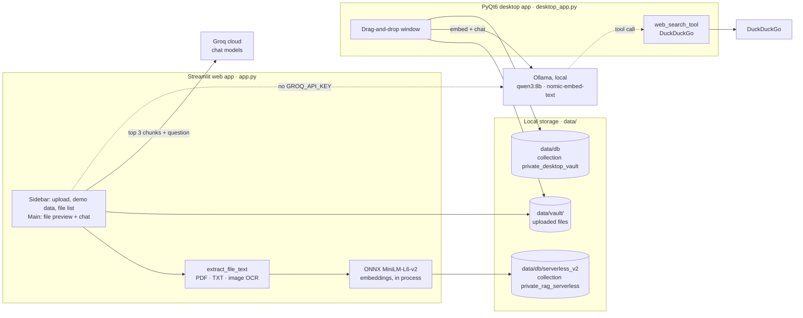
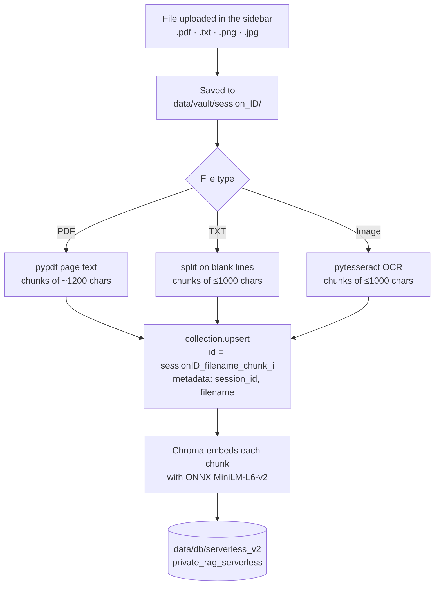
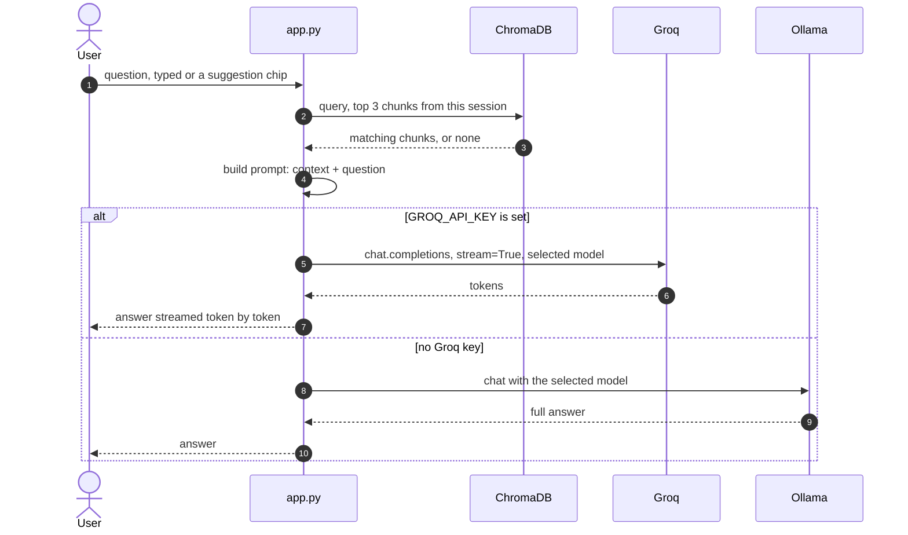
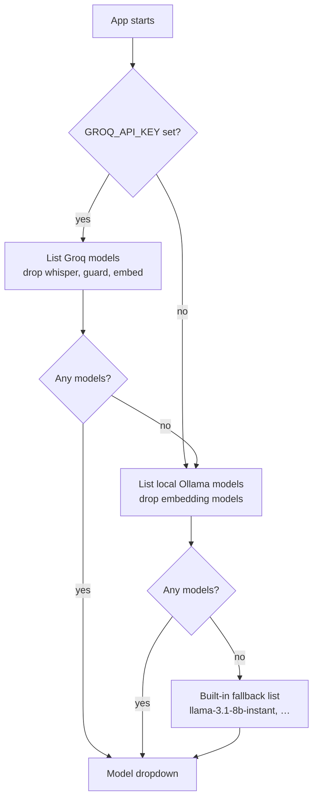
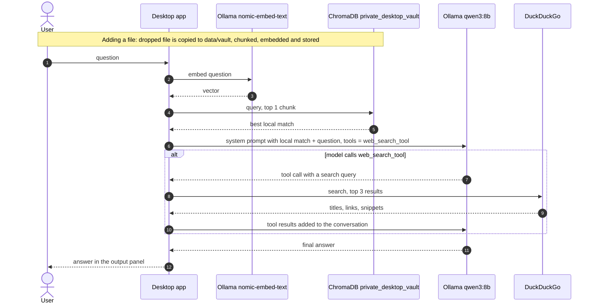
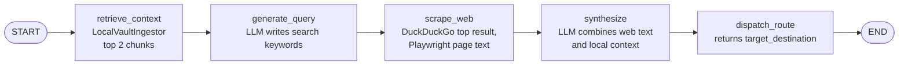

# Private RAG Desktop Agent Workspace 🧠

A cost-efficient Retrieval-Augmented Generation (RAG) workspace. Documents are embedded and searched in a local ChromaDB vector store, and answers are generated by a Groq cloud model, with a local Ollama model as the fallback.

The repo has two front ends:

- **`app.py`**: the Streamlit web app (deployed on Streamlit Cloud). Groq for answers, local ONNX embeddings, OCR for images.
- **`desktop_app.py`**: a PyQt6 desktop app that runs fully on your machine with Ollama, and can search the web when your documents aren't enough.

---

## 🗺️ Architectural Overview



`core/` holds an earlier LangGraph pipeline. Neither app imports it today; see [Unused LangGraph pipeline](#-unused-langgraph-pipeline-core).

---

## 🌐 Streamlit Web App (`app.py`)

### Adding a document



**Load Demo Sample Data** adds built-in sample documents (such as a travel policy) through the same `collection.upsert` path. Every chunk is tagged with the visitor's `session_id`, and questions only search that session's chunks.

### Asking a question



### Which model is used



The **Select Embedding Model** dropdown is currently display-only. Embeddings always use ONNX MiniLM-L6-v2.

---

## 🖥️ Desktop App (`desktop_app.py`)

Everything runs locally through Ollama. The model decides for itself whether to search the web.



Images are stored with a text description of the file name, not OCR, so their content isn't searchable in the desktop app.

---

## 🧩 Unused LangGraph Pipeline (`core/`)

`core/agent_graph.py` builds a fixed five-step LangGraph pipeline on Ollama (`gemma4:12b` and `nomic-embed-text`, from `config/settings.py`). Neither app imports it, and `core/retriever.py` is unused too.



---

## 📂 Project Directory Structure

```text
private-rag-agent/
│
├── app.py                 # Streamlit web app: upload, OCR, vector search, Groq/Ollama chat
├── desktop_app.py         # PyQt6 desktop app: fully local Ollama + DuckDuckGo tool calling
├── setup.py               # Install wizard: checks Ollama, asks consent, pulls local models
├── theme.py               # Streamlit CSS theme helper (not currently imported)
├── requirements.txt       # Python dependencies
├── packages.txt           # System packages for Streamlit Cloud (tesseract-ocr)
├── .streamlit/config.toml # Streamlit theme
│
├── config/
│   └── settings.py        # Paths (data/vault, data/db) and Ollama model names
│
├── core/                  # Earlier LangGraph pipeline, not used by either app
│   ├── agent_graph.py     # Five-node LangGraph pipeline
│   ├── ingestor.py        # Ollama-embedded Chroma vault for .txt files
│   ├── retriever.py       # Chroma query/delete/list helpers
│   └── scraper.py         # Playwright + BeautifulSoup page text extractor
│
└── data/                  # Local data, listed in .gitignore
    ├── vault/             # Uploaded files (session_<id>/ per web session)
    └── db/                # ChromaDB storage (serverless_v2/ for the web app)
```

---

## 🚀 Getting Started

### 1. Environment Configuration

Add your Groq API key to a local `.env` or to Streamlit Secrets:

```env
GROQ_API_KEY=your_production_groq_token_here
```

Without it, the web app falls back to a local Ollama server (`OLLAMA_HOST`, default `http://localhost:11434`).

### 2. Run the Web App Locally

```bash
streamlit run app.py
```

### 3. Run the Desktop App

Requires Ollama running locally with `qwen3:8b` and `nomic-embed-text` pulled:

```bash
python desktop_app.py
```
